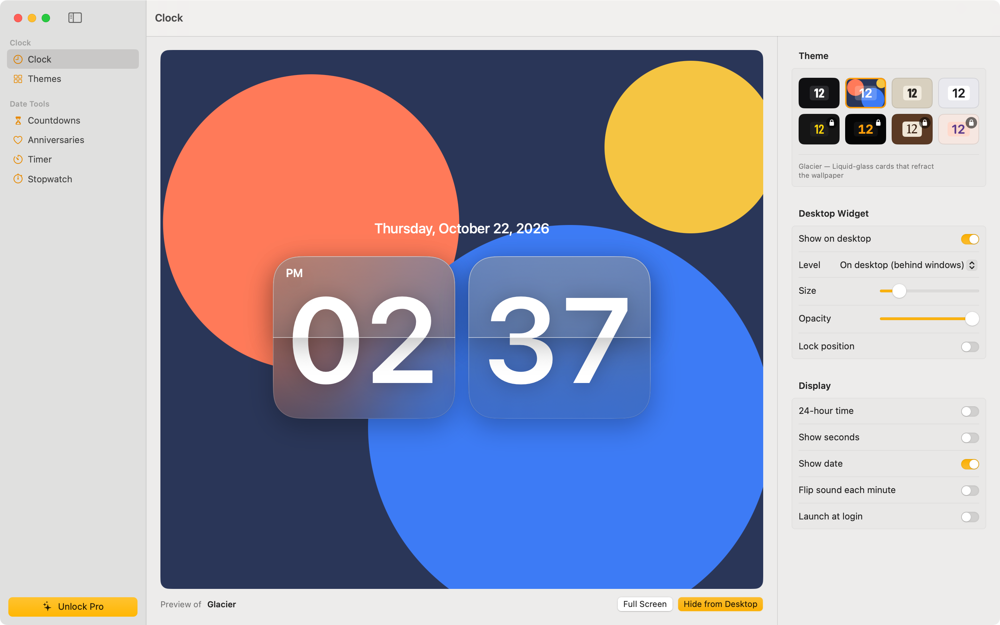

# Flipwise – Flip Clock for Mac

A flip clock for your Mac desktop, menu bar, widgets and full screen, with countdowns, anniversaries (including lunar dates), a focus timer and a stopwatch.

## Support

Questions, bug reports or feature ideas: **tongduoctuvien@gmail.com**

Please include your macOS version and, for bugs, what you were doing when it happened.

## Frequently asked questions

**How do I add the widgets?**
Right-click the desktop, choose **Edit Widgets…**, search for "Flipwise" and drag a Clock, Countdown or Anniversary widget where you want it.

**How do I move or hide the desktop clock?**
Drag it anywhere. Right-click it to change theme, size or level, lock its position, or hide it. You can bring it back from the menu bar item or the Clock screen.

**I bought Flipwise Pro on another Mac. How do I get it here?**
Open Flipwise › Flipwise Pro… and click **Restore Purchases**, signed in with the same Apple ID.

**How do lunar repeats work?**
Choose "Every lunar year" when editing an event. Flipwise finds the same lunar day and month each year (Vietnamese calendar, UTC+7), which suits Tết, lunar birthdays and memorial days.

**Does Flipwise collect my data?**
No. See the [Privacy Policy](privacy.html).

---

# Hỗ trợ (Tiếng Việt)

Góp ý, báo lỗi hoặc đề xuất tính năng: **tongduoctuvien@gmail.com**

- **Thêm widget:** chuột phải lên desktop › Edit Widgets… › tìm "Flipwise".
- **Khôi phục gói Pro:** Flipwise › Flipwise Pro… › Restore Purchases (cùng Apple ID).
- **Lặp theo âm lịch:** chọn "Every lunar year" khi sửa sự kiện.

[Chính sách quyền riêng tư](privacy.html)
